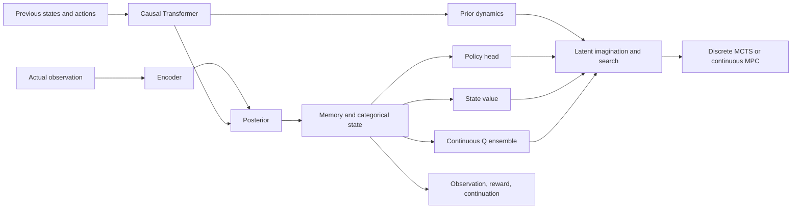

# Survival Agent

**The intended research model combines Transformer memory, Dreamer-inspired
world modeling and imagination learning, MuZero-inspired discrete MCTS, and
TD-MPC2-inspired continuous Q learning and MPC.** This is an experimental hybrid,
not a reproduction of the three reference algorithms.

**Read [model.py](survival_agent/hybrid/model.py) for the entire neural architecture.**
`HybridModel` is the combined model. It contains no search loop, environment
interaction, action selection or optimizer. Those use its predictions from separate
modules. The earlier `TransformerModel` remains in that file for existing baselines.

| Component | Implementation |
|---|---|
| Transformer | Causal numeric state/action history, learned positions, attention and feed-forward residual blocks. |
| Dreamer-inspired world model | Observation encoder, categorical prior/posterior, explicit per-stream memory, reconstruction, reward and continuation heads. |
| Policy and state value | Discrete logits or bounded continuous-action Gaussian parameters, plus a separate state-value head. |
| TD-MPC2-inspired Q ensemble | Separate continuous state/action value networks; real-replay TD targets use the actual next observation. |
| MuZero-inspired search | [planning.py](survival_agent/hybrid/planning.py): MCTS using actor priors, latent transitions, value leaves and discounted backups. |
| Continuous MPC | Same planner module: bounded trajectories, actor proposals, shifted warm starts and exponentially weighted elite optimization. |
| Learning | [learning.py](survival_agent/hybrid/learning.py): replay-seeded imagination, lambda returns, detached advantages, target critics, real TD and optional planner distillation. |
| Agent execution | [runtime.py](survival_agent/hybrid/runtime.py): per-stream state, episode resets and actor/MCTS/MPC dispatch. Environment execution stays in the integration repository. |

The default memory has one layer, four heads, width 32 and a 16-token window.
Its categorical latent has four variables with four choices each. Inputs are
numeric observations, not text. Discrete tasks use MCTS; continuous tasks use MPC;
`planning=False` selects the actor. Both planners use the same world model and
never receive an environment. They do not run together on every action.



**Validation:** bounded CPU checks run world-model learning, imagined policy/value
updates, optional distillation, and the appropriate planner on CartPole/Pendulum.
Tests cover known toy planner choices, gradient isolation, final-observation TD,
termination/truncation, root masks, reset behavior and safe optimizer/RNG resume.
These establish implementation behavior, **not useful learned control**. Actor-only
learning gains, held-out learned-model accuracy, multi-seed planner comparisons,
continual learning and skill retention remain unproven. The public social game
and its hosted diagram have not been changed by this implementation.

[Implementation details, reference deviations and runnable commands](docs/hybrid-combination.md).

## Earlier implementations and larger plan

The [Draft-2 hybrid design](docs/hybrid-draft2.md) includes
[data/replay/checkpoint foundations](docs/hybrid-stage-a.md) and the preserved
[GRU world model](docs/hybrid-stage-b.md). The transformer replaces temporal memory
for the current path at the researcher's request. The combined implementation adds
imagination learning and planners; research acceptance gates remain open. Earlier model files below are separate prototypes,
not additional components silently running inside the transformer agent.

[Research notes and implementation index](docs/README.md) includes the saved
[continual-learning/plasticity proposal and Nature reference](docs/online-plasticity-review.md).
The recycling and replay changes described there are proposed, not implemented.

Canonical experimental models, local language backend, bounded latent search and model-state serialization. The concrete grid environment is independently maintained in [survival-env](https://github.com/Nova-Rift/survival-env). World collection, adapters, combined checkpoints and examples live in [survival-agent-pilot](https://github.com/Nova-Rift/survival-agent-pilot).

## Quickstart from this checkout

Python 3.10+, NumPy, Torch and safetensors must already be available. No model download or Transformers is needed for these commands:

```bash
python -B -m examples.inspect_model
OPENBLAS_NUM_THREADS=1 OMP_NUM_THREADS=1 MKL_NUM_THREADS=1 python -B -m unittest discover -v
```

The example runs randomly initialized model heads on synthetic observations and checks finite logits/values. There are no optimizer updates, downloaded weights, APIs or useful trained results. Tests block all concrete-environment and integration imports.

## Dependencies and limits

`requirements.txt` and package metadata define NumPy, security-oriented Torch/safetensors minimums; `requirements-language.txt` and the `language` extra add Transformers/Jinja2. **Fresh dependency installation and wheel build are untested.** Functional checks used legacy Python 3.10.12, NumPy 1.26.4, Torch 2.2.0+cu121 and safetensors 0.4.5 on CPU. This legacy runtime has known advisories; passing checks are not security certification. No dependencies were installed or upgraded.

`HistoryAgent` consumes `(batch, history, 5, obs_width, obs_width)`, normally history 4 and width 5. `LanguageLatentCore` consumes bounded feature vectors. Existing policy heads use **five discrete actions**. `MuZeroModel`/`mcts` provide a minimal PUCT/replay/unroll research scaffold, not full MuZero. Importing core models/search never imports a concrete simulator. Legacy simulator and CLI modules are forwarding shims: explicitly invoking one requires the corresponding environment/integration checkout on the Python path. Combined checkpoint and collector helpers also delegate lazily to pilot adapters. Collectors and environment reconstruction belong in the pilot adapters, not here.

The optional language backend accepts vetted local directories and safetensors only; it does not implicitly download. Scratch language mode is random weights with a byte vocabulary. Supported pretrained integration keeps the encoder frozen; full pretrained fine-tuning is unsupported. Some language formatting remains survival-specific. This package does not promise arbitrary observation/action spaces, continuous controls or policy transfer.

## Checkpoints

`checkpoint_io` uses bounded structured JSON and safetensors, rejecting pickle/Torch legacy archives, unknown types, unsafe arrays and nonfinite metadata. Episode dimensions are checked before replay boundary arithmetic. Model-only state belongs here; combined model/world state belongs in pilot adapters. Source/runtime mismatch may intentionally reject resume. Never bypass provenance checks or publish private checkpoints. See [security scope](SECURITY.md).

## Ownership

Edit model/search/serialization code here. The pilot repo will pin this repository rather than maintain another copy. Source was extracted from pilot commit `be2e3f43b972a6cd83b0f31f420abdfd3b3a7f1e`; prior development history stays there. No project source license has been selected; public visibility is not an open-source license grant. Third-party pretrained artifacts retain their own licenses.
