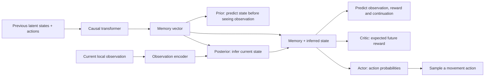

# Survival Agent

An experimental agent that learns from a small survival world. It sees nearby
cells, remembers recent experience, and chooses a movement action.

**Start with [transformer_agent.py](survival_agent/hybrid/transformer_agent.py).**
The current architecture and action selection are in this one readable file:
configuration, memory, transformer, world-model heads, actor and critic. It uses
PyTorch's standard transformer layer; environment, replay and training loops live
outside the model file. You can understand the model without tracing the older prototypes.

**Status:** the transformer path passes a small CPU training and checkpoint-replay
check. It has not had a held-out survival comparison. Earlier measured survival
results belong to the preserved GRU model; the website still runs a scripted policy.

## How one step works

1. **See:** each agent receives a 5 × 5 local view with eight numeric channels.
   It cannot see the overhead map or other agents' private memories.
2. **Remember:** add the previous compact state and action to that agent's history.
   A causal transformer reads up to 16 recent tokens and produces a memory vector.
3. **Estimate the present:** combine that memory with the current observation to
   infer a compact state. This is the **posterior**: what the agent believes after looking.
4. **Act:** the **actor** turns memory plus inferred state into probabilities for
   wait, up, right, down and left. Sample one action from those probabilities.
5. **Repeat:** the world applies the action and supplies the next observation and
   reward. History resets at a new episode. Each agent has separate history;
   all eight agents use the same weights.



The default transformer has **one layer, four attention heads and width 32**.
The inferred state contains four categorical variables with four choices each.
Flattening those choices gives 16 numbers; concatenating them with the 32-number
memory gives the 48 features used by the actor, critic and prediction heads.
These history tokens are numeric state/action vectors, not words.

## Which part does what?

| Part | Purpose in this agent | Current status / code |
|---|---|---|
| Observation encoder | Converts the local numeric view into features. | Implemented: `TransformerWorldModel.encoder`. |
| Transformer / working memory | Relates recent state/action tokens using causal attention. Cannot attend to future tokens or another agent's history. | Implemented: `CausalMemory`, `_advance`. |
| World model | Predicts a latent state before seeing the next observation (**prior**), infers it after seeing it (**posterior**), and predicts observations, reward and whether operation continues. | Implemented: `TransformerWorldModel`. Prediction quality is not established by a smoke test. |
| Reinforcement learning: actor | Chooses actions. Training increases the probability of actions with higher estimated returns relative to the critic's estimate. | Implemented: `TransformerAgent.actor`, `predict`, `act`. |
| Reinforcement learning: critic | Estimates discounted future alive-step rewards; helps train the actor. | Implemented: `value`, `target_value`, `update_target`. A value is a return estimate, not a survival probability. |
| Replay | Stores real experience for world-model fitting. Reconstructs history from episode starts. | Implemented infrastructure: [replay.py](survival_agent/hybrid/replay.py). This alone is not a forgetting-prevention algorithm. |
| Text / language | Would encode text or support language interaction. | **Not connected to this agent.** The separate older [language_backend.py](survival_agent/language_backend.py) supports optional local language models. No language model is loaded by the current path. |
| Continual learning | Would keep learning during ongoing experience while retaining older skills. | **Not implemented or demonstrated as a complete capability.** Current training has separate world-model and policy phases. |
| Forgetting protection / plasticity | Would preserve older skills and maintain the ability to learn new ones. | **Not implemented or tested here.** [Replay/recycling proposals](docs/online-plasticity-review.md) remain proposals. Freezing the world model during policy training prevents those updates from changing it, but does not demonstrate continual learning. |
| Planning / imagination | Would compare predicted future action sequences before choosing an action, or learn policy from imagined experience. | **Not used by this path.** Actions come directly from the actor. |

## What training changes

**First, learn the world model from real sequences.** Fit observation reconstruction,
reward prediction and continuation prediction. Also train the prior and posterior
to agree using balanced KL losses. The transformer and observation/prediction heads
all receive gradients. The shared [sequence loss and optimizer](survival_agent/hybrid/world_model.py)
implement this fitting loop; the historical GRU model is preserved in that file too.

**Then, freeze the world model and learn actions through interaction.** The actor
and critic train from 16-step real rollouts. Each agent earns 1 when still alive
after a step and 0 on its death transition. Discounted returns bootstrap from a
slowly updated target critic when appropriate; death stops bootstrapping, while a
time-limit cutoff keeps its final-observation value. Inactive agents are masked.
The loss combines an actor objective, value prediction error and an entropy term
to encourage exploration. [Collection and policy updates](https://github.com/Nova-Rift/survival-agent-pilot/blob/hybrid-stage-b-survival/survival_adapters/synthetic_control.py)
are shared with the preserved baseline; [the current transformer driver](https://github.com/Nova-Rift/survival-agent-pilot/blob/hybrid-stage-b-survival/survival_adapters/transformer_control.py)
selects this model and controls the bounded run.

World-model fitting samples categorical latent states. During control, the
posterior uses each category's most likely choice, while **actions are sampled**
from the actor's probabilities. The transformer has no dropout.
Its 16-token attention window is working memory; it is not long-term skill retention.
Older information can still influence later tokens through inferred states.

For the tested command, budgets and checkpoint limits, see the
[transformer integration guide](https://github.com/Nova-Rift/survival-agent-pilot/blob/hybrid-stage-b-survival/docs/transformer-agent.md).

## Earlier implementations and larger plan

The [Draft-2 hybrid design](docs/hybrid-draft2.md) includes
[data/replay/checkpoint foundations](docs/hybrid-stage-a.md) and the preserved
[GRU world model](docs/hybrid-stage-b.md). The transformer replaces temporal memory
for the current path at the researcher's request. Imagination learning and the
new planners remain unfinished. Earlier model files below are separate prototypes,
not additional components silently running inside the transformer agent.

[Research notes and implementation index](docs/README.md) includes the saved
[continual-learning/plasticity proposal and Nature reference](docs/online-plasticity-review.md).
The recycling and replay changes described there are proposed, not implemented.

Canonical experimental models, local language backend, bounded latent search and model-state serialization. The concrete grid environment is independently maintained in [survival-env](https://github.com/Nova-Rift/survival-env). World collection, adapters, combined checkpoints and examples live in [survival-agent-pilot](https://github.com/Nova-Rift/survival-agent-pilot).

## Quickstart from this checkout

Python 3.10+, NumPy, Torch and safetensors must already be available. No model download or Transformers is needed for these commands:

```bash
python -B -m examples.inspect_model
OPENBLAS_NUM_THREADS=1 OMP_NUM_THREADS=1 MKL_NUM_THREADS=1 python -B -m unittest discover -v
```

The example runs randomly initialized model heads on synthetic observations and checks finite logits/values. There are no optimizer updates, downloaded weights, APIs or useful trained results. Tests block all concrete-environment and integration imports.

## Dependencies and limits

`requirements.txt` and package metadata define NumPy, security-oriented Torch/safetensors minimums; `requirements-language.txt` and the `language` extra add Transformers/Jinja2. **Fresh dependency installation and wheel build are untested.** Functional checks used legacy Python 3.10.12, NumPy 1.26.4, Torch 2.2.0+cu121 and safetensors 0.4.5 on CPU. This legacy runtime has known advisories; passing checks are not security certification. No dependencies were installed or upgraded.

`HistoryAgent` consumes `(batch, history, 5, obs_width, obs_width)`, normally history 4 and width 5. `LanguageLatentCore` consumes bounded feature vectors. Existing policy heads use **five discrete actions**. `MuZeroModel`/`mcts` provide a minimal PUCT/replay/unroll research scaffold, not full MuZero. Importing core models/search never imports a concrete simulator. Legacy simulator and CLI modules are forwarding shims: explicitly invoking one requires the corresponding environment/integration checkout on the Python path. Combined checkpoint and collector helpers also delegate lazily to pilot adapters. Collectors and environment reconstruction belong in the pilot adapters, not here.

The optional language backend accepts vetted local directories and safetensors only; it does not implicitly download. Scratch language mode is random weights with a byte vocabulary. Supported pretrained integration keeps the encoder frozen; full pretrained fine-tuning is unsupported. Some language formatting remains survival-specific. This package does not promise arbitrary observation/action spaces, continuous controls or policy transfer.

## Checkpoints

`checkpoint_io` uses bounded structured JSON and safetensors, rejecting pickle/Torch legacy archives, unknown types, unsafe arrays and nonfinite metadata. Episode dimensions are checked before replay boundary arithmetic. Model-only state belongs here; combined model/world state belongs in pilot adapters. Source/runtime mismatch may intentionally reject resume. Never bypass provenance checks or publish private checkpoints. See [security scope](SECURITY.md).

## Ownership

Edit model/search/serialization code here. The pilot repo will pin this repository rather than maintain another copy. Source was extracted from pilot commit `be2e3f43b972a6cd83b0f31f420abdfd3b3a7f1e`; prior development history stays there. No project source license has been selected; public visibility is not an open-source license grant. Third-party pretrained artifacts retain their own licenses.
